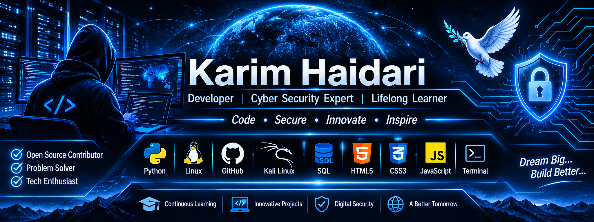

# Karim Haidari

  

## 👋 About Me

Welcome to my GitHub profile!

I'm interested in technology, programming, Python, and ethical cybersecurity.

I'm a beginner developer learning step by step and building practical projects.

## 💻 Skills

- Basic Python
- GitHub
- Termux
- Canva
- Programming Fundamentals

## 📚 Currently Learning

- Python
- JavaScript
- HTML & CSS
- Bash
- Git
- Linux and Linux Distributions
- Cybersecurity Fundamentals
- Network Security
- Ethical Hacking

## 🛠️ Tools & Technologies

- Visual Studio Code
- Kali Linux
- Ubuntu
- Wireshark
- Nmap
- Burp Suite
- Metasploit
- OWASP ZAP
- Jupyter Notebook
- Figma

## 🎯 My Goals

- Improve my programming skills.
- Build practical Python projects.
- Develop my cybersecurity knowledge.
- Learn ethical hacking responsibly.
- Create useful technology projects.

---

I'm always learning, improving, and exploring new technologies.
